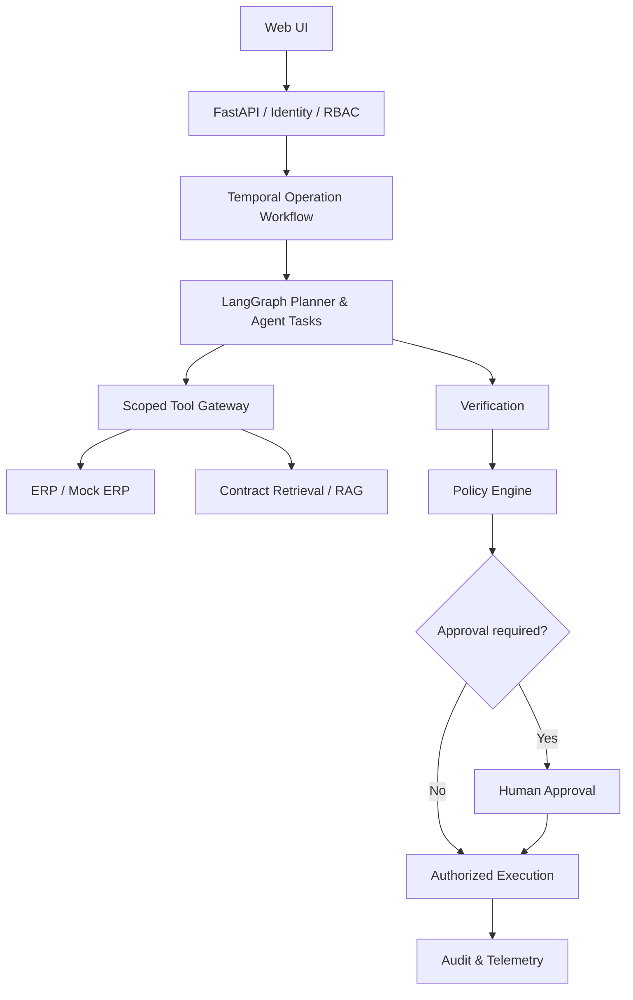

# Enterprise Autonomous Multi-Agent AI Platform

> **Status:** Architecture and planning — implementation not yet started.

An enterprise-oriented, goal-driven AI operations platform that translates business objectives into verifiable plans, coordinates specialized agents, and executes approved actions through durable workflows.

## The problem
Enterprise processes span ERPs, document stores, communications and project systems. Manual handoffs slow operations, while unconstrained agents introduce security, reliability and auditability risks.

## Proposed solution
A **goal-first** platform combining agentic planning with deterministic, policy-controlled execution. The initial vertical is **Procurement & Supplier Risk Operations**: identify late purchase orders, cross-check supplier contracts, assess project impact, propose follow-ups, and request human approval before external actions.

## Core design principles
- **Evidence before action:** cite source records and document passages for consequential findings.
- **Policy outside the model:** LLM recommendations never grant permissions.
- **Human oversight:** external communications and financial changes require configured approvals.
- **Durable operations:** resumable execution, bounded retries, idempotent side effects.
- **Tenant isolation:** enforce access controls at API, tool, retrieval and persistence boundaries.
- **Measurable reliability:** evaluate task completion, retrieval, policy enforcement, recovery and cost.

## Illustrative user journey
1. User requests: *Review overdue purchase orders, compare contractual terms, identify affected projects and prepare supplier follow-ups.*
2. API authenticates user and validates tenant-scoped access.
3. Planner produces a structured, dependency-aware task plan.
4. Data and document tools retrieve permitted records and citations.
5. Analysis computes delays using deterministic rules; agents summarize risk and evidence.
6. Verification checks completeness and flags missing or conflicting evidence.
7. Policy engine gates actions; human approver reviews proposed emails.
8. Durable workflow sends only approved communications and records audit events.

## Architecture at a glance

## Documentation
| File | Purpose |
|---|---|
| [PROJECT_PROPOSAL.md](docs/PROJECT_PROPOSAL.md) | Business case, value and scope |
| [PRD.md](docs/PRD.md) | Personas, requirements and acceptance criteria |
| [SYSTEM_ARCHITECTURE.md](docs/SYSTEM_ARCHITECTURE.md) | Components, trust boundaries and data flow |
| [TECHNICAL_DESIGN.md](docs/TECHNICAL_DESIGN.md) | Agents, contracts, persistence, APIs and failure handling |
| [TECH_STACK.md](docs/TECH_STACK.md) | Technology choices and trade-offs |
| [ROADMAP.md](docs/ROADMAP.md) | Milestones, deliverables and exit gates |
| [EVALUATION_PLAN.md](docs/EVALUATION_PLAN.md) | Evaluation datasets, metrics and safety tests |

## Planned MVP
- Tenant-aware workspace and authentication
- Mock ERP connector and contract ingestion
- Structured goal-to-plan generation
- Retrieval, procurement analysis, risk and verification capabilities
- Human approval queue and durable execution
- Audit logs, traces and an evaluation harness

## Non-goals for MVP
- Fully general no-code workflow builder
- Unsupervised payments or contract amendments
- Hundreds of production integrations
- Claims of production readiness or benchmark performance without evidence

## Development status
All features are **planned**. No deployment, benchmark, security certification or customer results are claimed.

## Getting started
This repository currently contains planning documentation only. Implementation scaffolding and executable setup instructions will be added during Phase 1. See [ROADMAP](docs/ROADMAP.md).

## License
License to be selected before publishing implementation code. No license is granted by default.
