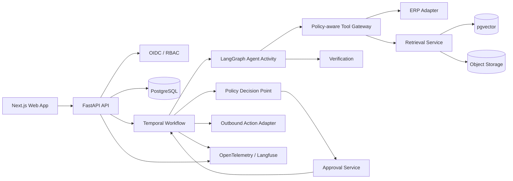

# System Architecture

## Status
Proposed reference architecture. Validate with prototypes and load/security tests before production use.

## Architecture goals
Separate probabilistic reasoning from deterministic authorization and side effects; support long-running tasks, tenant isolation, evidence provenance and observable failure recovery.

## Control plane vs execution plane
**Control plane:** tenants, users, roles, policies, connector configuration, budgets, templates and audit queries.

**Execution plane:** operation lifecycle, agent task scheduling, retrieval, deterministic calculations, approvals and external actions.

## Request flow
1. Authenticate and resolve tenant, role and operation limits.
2. Persist operation with correlation ID and immutable request snapshot.
3. Start Temporal workflow and request typed plan from LangGraph activity.
4. Validate plan against tool registry, budgets, allowed scopes and dependency graph.
5. Execute read-only retrieval and analysis tasks; record source provenance.
6. Run verification and independent policy evaluation.
7. Wait for approval where required; approval references action hash and expiration.
8. Execute side effects through idempotent adapters; persist receipts and final status.

## Trust boundaries
- Browser is untrusted: never accept role or tenant claims from UI alone.
- LLM outputs and retrieved documents are untrusted: validate schemas and ignore embedded instructions attempting tool escalation.
- Connector credentials stay server-side and are scoped to tenant and action.
- Policy decision point is deterministic and separate from LLM reasoning.
- Retrieval enforces tenant and document ACLs before ranking and before content is returned.

## State ownership
- **Temporal:** authoritative long-running operation lifecycle, timers, retry policies, signals and approvals.
- **LangGraph:** bounded agent reasoning state within a workflow activity; checkpoint only where justified.
- **PostgreSQL:** domain entities, user-visible projections, approvals and audit events.
- **Object storage:** uploaded documents and large artifacts.

Avoid dual ownership of lifecycle transitions. Synchronize user-facing projections from workflow events using idempotent updates.

## Deployment evolution
**Local:** Docker Compose with API, worker, PostgreSQL, Temporal development server, object storage emulator and web UI.

**Later:** separate workers, managed secrets, network segmentation, autoscaling, backups, monitoring, policy-as-code and disaster-recovery tests.

## Data isolation
All primary entities include `tenant_id`; authorization checks apply to queries, object keys, vector search and tool invocations. Consider PostgreSQL row-level security as defense in depth; test it explicitly.

## Failure modes
| Failure | Expected behavior |
|---|---|
| ERP timeout | Bounded retry with exponential backoff; partial/paused status |
| Missing contract | Mark evidence incomplete; do not invent clause |
| LLM malformed JSON | Validate and retry within limit; then fail task explicitly |
| Approval expires | Block action and request fresh approval |
| Worker crashes | Resume via Temporal history; reconcile external action receipts |
| Duplicate event | Idempotency key prevents duplicate side effect |
| Cross-tenant retrieval attempt | Deny and log security event |

## Diagram assumptions
Email sending is a high-impact side effect requiring approval by default. All production integrations and policies must be reviewed for the target enterprise environment.
